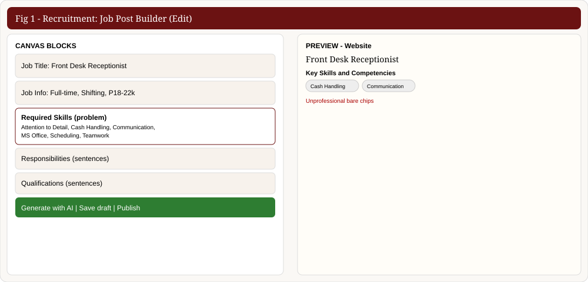
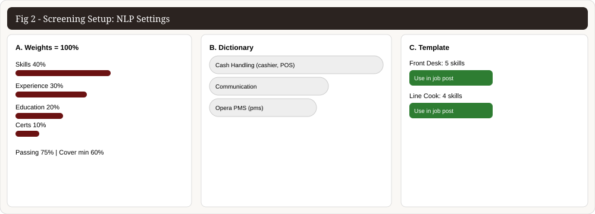
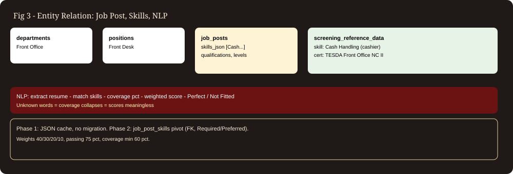

# Job Posting to NLP Screening — Complete Process Documentation

> Purpose: explain in very detailed but simple terms how a Job Post is created,
> how it is connected to NLP entities, and the overall end-to-end flow.
> Audience: classmates / panel / anyone giving suggestions.
> System: Oxford Suites Makati HRMS — Recruitment Management + Applicant Management + NLP Service.

## Figures (images of Job Post Builder, NLP, and Entity Relation)



*Fig 1 — Your Job Post Builder: left canvas blocks (Job Title, Job Info, Required Skills with single-word tags), right live Website preview showing the unprofessional Key Skills chip cloud.*



*Fig 2 — Your NLP Settings (Screening Setup): A. score weights 40/30/20/10 with passing 75%, B. skills dictionary with aliases, C. requirement template with Use in job post.*



*Fig 3 — How job_posts.skills_json + screening_reference_data feed the Python NLP scorer, and Phase 1 (JSON) vs Phase 2 (pivot table) plan.*

> Interactive clickable versions (open in browser, no login):
> - `preview-recruitment-interactive.html` — tabs like your real UI, editable builder, draggable NLP weights
> - `preview-fig1-builder.html`, `preview-fig2-nlp.html`, `preview-fig3-entity.html` — single-figure pages for screenshots (Win+Shift+S)

---
## 1. Big Picture — Overall Process in One Page

```
STAFFING NEED                    JOB POSTING                    APPLICANT                    SCREENING (NLP)              HIRING
─────────────                    ───────────                    ─────────                    ───────────────              ──────
Dept needs staff            →    HR builds job post         →   Applicant applies       →   Resume auto-scored      →   Interview → Assessment
(Requisition)                    (Job Post Builder)               (Website / Walk-in)          (Python NLP + spaCy)          → Hire → Onboarding
```

**In simple words:**
1. A department says “we need 3 Front Desk staff” (Requisition).
2. HR writes a Job Post (title, salary, responsibilities, qualifications, skills).
3. The post is Published to Website / Facebook / Instagram / Indeed.
4. Applicants send resumes through the posting.
5. The NLP (smart reader) reads each resume, compares it to the job post requirements, and gives a score (e.g. 89%).
6. HR interviews only the high scorers, then hires.

**Why the Job Post matters so much:** the Job Post IS the answer key. The NLP compares every resume against it. If the Job Post has messy skills like “Teamwork” with no meaning, the score becomes meaningless.

---
## 2. Step-by-Step — Job Posting Process (Recruitment Management)

### Step 1 — Staffing Request (Requisition)
- Where: `Recruitment → Requisitions` tab.
- Who: Department head requests headcount (e.g. REQ-01015: 3× Front Desk Receptionist).
- Table: `requisitions` (requested_count, position_id, department_id, status=Pending/Approved).
- Action: HR clicks **Convert → Builder**. This pre-fills position + vacancies so HR never types them twice.

### Step 2 — Job Post Builder (Edit Job Post)
- Where: `Recruitment → Job Post Builder` tab.
- File: `frontend/src/components/modules/RecruitmentManagement.tsx`
- Entry: pick Position (e.g. Front Desk Receptionist) → draft auto-fills salary band + vacancies from Core HCM.
- Canvas blocks (9 draggable blocks, 6 AI-fillable):

| # | Block | What HR writes | Stored in |
|---|-------|----------------|-----------|
| 1 | Job Title | picked, not typed (from `positions.title`) | derived on save |
| 2 | Job Info | type, schedule, vacancies, salary, education, experience | `job_posts` columns |
| 3 | Job Description | 2–3 sentence pitch | `description` (text) |
| 4 | Key Responsibilities | 5–7 bullets, what they WILL DO | `responsibilities_json` |
| 5 | Qualifications | 4–6 bullets, what they MUST HAVE | `qualifications_json` |
| 6 | **Required Skills** | 6–10 single words/tags ← **problem area** | `skills_json` |
| 7 | Application Instruction | how to apply | (instructions text) |
| 8 | About Company | hotel blurb | (about text) |
| 9 | Picture of Hiring | poster upload | `picture` |

## 3. Database Entities — How Job Posts Are Stored

```
departments ──1:N──> positions ──1:N──> job_posts ──1:N──> applicants
     │                    │                  │
     │                    │                  └──1:N──> job_post_platforms
     │                    └──N:1──> salary_grades (min/max band)
     │
     └── (requisitions request headcount per position)
```

**Key tables:**
- `departments` (department_id, name) — e.g. Front Office.
- `positions` (position_id, title, department_id, salary_grade_id, headcount) — Core HCM truth. Title never typed in builder.
- `job_posts` (job_post_id, slug, title [derived], department_id, position_id, employment_type, schedule, salary_min/max, vacancies, filled_count, status Open/Closed/Draft, education_level, experience_level, summary, description, responsibilities_json, qualifications_json, **skills_json**, picture).
- `screening_reference_data` (ref_id, data_type, canonical_value, aliases_json) — the NLP dictionary. data_type = skill | job_role | certification | education | experience.
- `screening_requirement_templates` + `screening_requirement_template_items` — per-position reusable requirements (e.g. Front Desk → 5 skills + cert + education + experience).
- `applicants` + `applicant_screenings` (profile_json, score_breakdown, match_score, reasons) — screening results.

**Current relation for skills (Phase 1 — JSON, no FK):**
- `job_posts.skills_json` = plain list of strings, e.g. `["Cash Handling","Communication"]`.
- No foreign key. Backend canonicalizes against `screening_reference_data` on AI-generate, but manual typing is unchecked.
- `ScreeningService::buildRequirements()` reads `skills_json` as `required_skills` — this is the ONLY field the NLP scores as skills.

**Proposed relation (Phase 2 — true pivot, if skills block is removed from UI):**
- New `job_post_skills (job_post_id FK, skill_ref_id FK → screening_reference_data, level required/preferred)`.
- UI checklist writes to pivot; `skills_json` kept as read-cache during transition; `ScreeningService` reads pivot first, falls back to JSON.
- Benefit: rename/alias in one place, analytics, no drift. Cost: migration + backfill + resource change.

---
## 4. NLP / Entity Connection — How Job Post Becomes a Score

### 4.1 The three inputs to every screening
Every time a resume is screened, Laravel sends the Python NLP service (`nlp-service`, FastAPI, spaCy) a package with 3 parts:

1. **requirements** — built from the Job Post (`ScreeningService::buildRequirements`):
   - `required_skills` ← `job_posts.skills_json` (e.g. Cash Handling, Communication…)
   - `required_certifications` ← extracted from `qualifications_json` lines matching NC / TESDA / certificate / license
   - `education_level` ← `job_posts.education_level`, `experience_level` ← `job_posts.experience_level`
2. **reference_data** — the dictionary (`screening_reference_data` grouped as skills / job_roles / certifications + aliases). Sent per request; bundled seed JSON is fallback only.
3. **screening_settings** — HR weights/thresholds (`system_settings[key=screening.configuration]`): Skills 40%, Experience 30%, Education 20%, Certs 10%, passing 75%, skills coverage min 60%.

### 4.2 What the NLP does (5 stages, simple words)
1. **Read** — extract text from PDF/DOCX/image (OCR if needed).
2. **Understand (NER)** — spaCy finds PERSON, EMAIL, PHONE, EDUCATION, JOB_TITLE, SKILL, CERTIFICATION. Each SKILL is canonicalized against reference_data (aliases count, e.g. “cashier” → Cash Handling). Unknown words → `unrecognized_skills`.
3. **Compare** — resume skills vs `required_skills` → matched / fuzzy-matched / missing → `required_coverage` (e.g. 4/5 = 80%). Same for certs, education level check, experience years estimate vs minimum.
4. **Score** — weighted sum: Skills 40 + Experience 30 + Education 20 + Certs 10 = 0–100. Example: 32 + 30 + 20 + 10 = 92%.
5. **Decide** — status: Perfect for the Job (≥75% + coverage ≥60%), Fit for Other Job (best other open post ≥ threshold), Invalid Credential, or Not Fitted. Also returns `alternative_job` (best other post) and `screening_reasons` (human-readable why).

### 4.3 Entity flow diagram
```
Job Post (skills_json, qualifications, levels)
   │ buildRequirements()
   ▼
requirements {required_skills, certs, education, experience}
   │ + reference_data (dictionary + aliases)
   │ + screening_settings (weights/thresholds)
   ▼
Python NLP (/screening/score): extract → NER → canonicalize → compare → score → classify
   ▼
applicant_screenings (profile_json, score_breakdown, match_score, reasons)
   ▼
applicants (fit_score, status) → Ranking → Interview → Hire
```
## 5. Concrete Example — Front Desk Receptionist

**Job Post (what HR saves):**
- Title: Front Desk Receptionist | Dept: Front Office | Type: Full-time | Schedule: Shifting Schedule
- Salary: ₱18,000–₱22,000 | Vacancies: 3 | Education: Bachelor's Degree | Experience: 1–2 Years
- Responsibilities: Welcome guests; Process check-in/out; Manage reservations; Handle complaints; Coordinate with housekeeping.
- Qualifications: Hospitality degree; Excellent communication; Basic computer skills; Customer service advantage.
- **skills_json: [Customer Service, Communication, Hotel Operations, Problem Solving, Time Management]**

**Dictionary (excerpt):** Cash Handling (cashier, POS cash), Communication, Opera PMS (pms), Check-in / Check-out, Reservations, MS Office (excel).

**Applicant resume (excerpt):** skills [Cash Handling, Communication, MS Office, Scheduling] → canonicalized → 2/5 required matched → coverage 40% → below 60% minimum → status Not Fitted (even if experience/education pass), with reason “Required-skills coverage 40% is below the 60% minimum. Missing: Customer Service, Hotel Operations…”.

**Lesson:** the post's word choice directly decides who passes. Professional sentences for humans + recognized keywords for matching must coexist — hence the proposal to fold skills into qualification sentences while keeping a hidden keyword list.

---
## 6. Overall End-to-End Flow (all modules)

1. **Core HCM** owns departments, positions, salary grades (truth, never retyped).
2. **Recruitment** converts requisition → builds job post → publishes to platforms.
3. **Landing (careers site)** lists posts (`/jobs`), applicant applies (`/jobs/$jobId` + resume upload).
4. **Applicant Management** receives applicant → `ScreeningService::screenAndPersist` → NLP score → ranking table.
5. **Screening Setup (NLP settings)** lets HR tune weights, passing score, dictionary, and requirement templates — applies to every NEW screening (old scores frozen for audit).
6. **Post-screening pipeline:** Interview → Assessment Test → Practical Test (if required) → Final Evaluation → Hire → auto-fills one vacancy slot (`fillOneSlot`, auto-closes at 0) → New Hire Onboarding.
7. **AI helpers:** JobContentGenerator (vocab-grounded drafts, never auto-publishes) + Chatbot (answers applicant questions from posts + FAQs). Usage/limits shown in builder indicator.

---
## 7. Known Issue + Recommendation (your Required Skills concern)

**Issue:** `skills_json` is machine data displayed raw to humans as “Key Skills & Competencies” chips. Single words (Attention to Detail, Teamwork) look unfinished vs Responsibilities/Qualifications sentences.

**Recommendation (Phase 1, no migration):** keep `skills_json` as HR-only hidden keywords for matching; public post shows only sentences (Responsibilities + Qualifications with skills woven in) + optional muted “Core competencies” pill row. Builder renames block to “Matching keywords (HR only, not shown)”. Screening, AI, templates untouched.

**Later (Phase 2, proper relation):** add `job_post_skills` pivot to `screening_reference_data` with Required/Preferred level; backfill from JSON; switch `ScreeningService` + `JobPostResource`; deprecate JSON. Gives FK integrity + analytics.

---
## 8. Files & Tables Reference

- Builder UI: `frontend/src/components/modules/RecruitmentManagement.tsx` (Draft, blocks, applyRequirementTemplateToDraft, generateDraftWithAI, save/publish)
- Public: `frontend/src/routes/_landing/jobs.index.tsx`, `jobs.$jobId.tsx` (+ `lib/landing.ts` mapJob)
- Backend: `Modules/RecruitmentManagement/{Models/JobPost.php, Http/{Controllers/RecruitmentManagementController.php, Requests/Store|UpdateJobPostRequest.php, Resources/JobPostResource.php}, database/migrations/2025_01_01_000001_*}`
- Screening: `Modules/ApplicantManagement/{Services/ScreeningService.php, Models/ScreeningReferenceData.php, Http/Controllers/ScreeningReferenceController.php, database/seeders/ScreeningRequirementTemplateSeeder.php}`
- Bridge: `backend-laravel/app/Services/{NlpService.php, JobContentGenerator.php}` + `nlp-service/app/main.py` (`/screening/score`, `/screening/reclassify`)
- Config: `system_settings[screening.configuration]` (weights 40/30/20/10, passing 75, coverage 60%)
- Docs: `docs/NLP_FEATURE_DOCUMENTATION.md`, `docs/JOB_POST_AI_GENERATION.md`, `docs/JOB_POST_EDITOR_ENTITY_ALIGNMENT.md`

*End of document — share this .md directly for suggestions (Q1–Q5 in showcase HTML).*


**Critical link:** if `skills_json` is empty or uses words NOT in the dictionary, `required_coverage` collapses → every applicant fails skills → scores meaningless. That is why vocabulary-grounded AI drafts and requirement templates exist: they force the post to reuse recognized terms.

---

- Helpers: **Generate with AI** (vocab-grounded draft), **Content Templates** (offline fallback), **Requirement Template picker** (one-click fill from position template).
- Buttons: **Save draft** (status=Draft, hidden) → **Publish job post** (status=Open, visible on careers site).
- Validation: vacancies ≥ 1, salary_max ≥ salary_min, at least one content block.

### Step 3 — Publish to Platforms
- Table: `job_post_platforms` (Website / Facebook / Instagram / Indeed, status=published).
- Preview tabs in builder show how the post looks per platform.
- Public pages: `/jobs` (cards with skill chips) and `/jobs/$jobId` (detail with Key Skills & Competencies chip cloud + Apply form).

---

